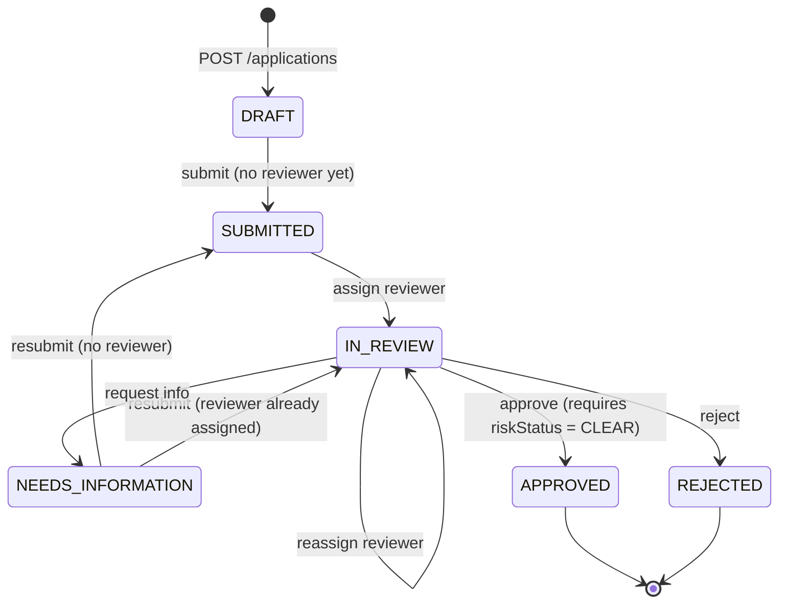

# Merchant Operations API

NestJS backend for merchant onboarding and risk review: sales create applications, an admin assigns a
reviewer, a background worker runs a (simulated) KYB/risk check, and the assigned reviewer records the decision.

**Stack:** NestJS 10 · TypeScript · PostgreSQL + TypeORM (migrations) · Redis + BullMQ · JWT · Swagger · Jest + Supertest · Docker Compose

Design decisions and trade-offs are in [docs/adr/001-architecture-decisions.md](docs/adr/001-architecture-decisions.md).

## Quick start

Prerequisites: Node.js 20+, Docker Desktop (running).

```bash
cp .env.example .env            # then fill in the three secrets below
docker compose up -d            # PostgreSQL 16 + Redis 7
npm install
npm run migration:run           # create the schema (synchronize is OFF)
npm run seed                    # dev users (needs SEED_PASSWORD in .env)
npm run start:dev
```

Fill in `.env` (never commit it):

| Variable | How to generate |
| --- | --- |
| `JWT_SECRET` | `openssl rand -base64 48` (min 32 chars) |
| `FIELD_ENCRYPTION_KEY` | `openssl rand -hex 32` (exactly 64 hex chars) |
| `SEED_PASSWORD` | any 12+ char password, used only by `npm run seed` |

Startup fails fast with a readable message if any required variable is missing or malformed.

- Swagger UI: <http://localhost:3000/docs> (use **Authorize** with the token from `/api/auth/login`)
- Health: `GET /api/health`

Seeded users (all use `SEED_PASSWORD`): `admin@example.test`, `reviewer1@example.test`, `reviewer2@example.test`,
`sales1@example.test`, `sales2@example.test`. All data is fictional.

## Roles and permissions

| Action | ADMIN | REVIEWER | SALES |
| --- | :---: | :---: | :---: |
| Create application | ✅ | ❌ | ✅ |
| View application | all | only **assigned to them** | only **their own** |
| Edit / submit (while `DRAFT` or `NEEDS_INFORMATION`) | all | ❌ | only **their own** |
| List applications | all | assigned to them | their own |
| Assign / reassign reviewer | ✅ | ❌ | ❌ |
| Record decision (approve / reject / request info) | ❌ | only the **assigned** reviewer | ❌ |
| Read audit trail | ✅ | assigned only | ❌ |

Two layers enforce this: a global `RolesGuard` (coarse, per route) and `ApplicationPolicy` (per object), evaluated
inside the same transaction and row lock that loads the application. Anything a caller may not see returns
**404**, not 403, so ids cannot be probed. See ADR-001 for why ADMIN cannot decide.

## Application lifecycle



Risk status is tracked separately: `NOT_STARTED → PENDING → CLEAR | FLAGGED | FAILED`.
Invalid transitions return **409 Conflict**. The transition rules are pure functions in
[`application-lifecycle.ts`](src/applications/application-lifecycle.ts).

## Asynchronous risk review

1. `POST /applications/:id/submit` commits `SUBMITTED` + `riskStatus=PENDING` + `submissionVersion+1`, then enqueues
   `check-application` with job id `risk-<applicationId>-<submissionVersion>` (returns **202**).
2. The worker ([`risk.processor.ts`](src/risk/risk.processor.ts)) calls a `RiskProvider` (a deterministic simulated KYB
   adapter, no network) **outside** any transaction, then writes the result under a row lock.
3. **Idempotency:** the write only happens while the row is still `PENDING` for that same `submissionVersion`.
   Duplicate deliveries, crash-retries and stale jobs from an earlier submission are no-ops.
4. **Retries:** `attempts=4` with exponential backoff starting at 1s (configurable via `RISK_JOB_ATTEMPTS`, `RISK_BACKOFF_MS`).
5. **Exhausted retries:** the application is marked `riskStatus=FAILED` (never left `PENDING`) and audited. Recovery:
   reviewer requests information → sales resubmits → new version → new job.
6. If Redis is down at submit time the submission is rolled back and the API returns **503**.
7. **Self-healing:** `RiskReconciler` runs every `RISK_RECONCILE_INTERVAL_MS` and re-enqueues applications stuck in `PENDING`
   longer than `RISK_RECONCILE_STALE_MS` whose job is missing (crash between DB commit and enqueue) or parked in BullMQ's
   `failed` set (the FAILED write was lost). Job ids are deterministic and the worker is idempotent, so this is safe to repeat.

Simulated provider rules (so behaviour is reproducible): business name containing `[timeout]` → provider outage on every
attempt; legal name containing `sanction`, monthly volume > 500,000, or average ticket > 10,000 → `FLAGGED`; otherwise `CLEAR`.
Only business facts are sent to the provider, never owner identity or contact details.

## API overview

| Method | Path | Notes |
| --- | --- | --- |
| POST | `/api/auth/login` | public; returns a bearer JWT |
| GET | `/api/auth/me` | current user |
| POST | `/api/applications` | create `DRAFT` |
| GET | `/api/applications?status=&riskStatus=&page=&limit=` | scoped to the caller, paginated (limit ≤ 100) |
| GET / PATCH | `/api/applications/:id` | PATCH only while editable |
| POST | `/api/applications/:id/submit` | enqueue risk job, 202 |
| POST | `/api/applications/:id/assign-reviewer` | ADMIN; target must be an active REVIEWER |
| POST | `/api/applications/:id/decision` | assigned REVIEWER |
| GET | `/api/applications/:id/audit` | ADMIN / assigned REVIEWER |

### Sample requests

```bash
BASE=http://localhost:3000/api

# 1. log in (sales)
TOKEN=$(curl -s $BASE/auth/login -H 'content-type: application/json' \
  -d '{"email":"sales1@example.test","password":"<SEED_PASSWORD>"}' | jq -r .accessToken)

# 2. create
curl -s $BASE/applications -H "authorization: Bearer $TOKEN" -H 'content-type: application/json' -d '{
  "businessName": "Acme Coffee",
  "legalBusinessName": "Acme Coffee Roasters LLC",
  "businessType": "LLC",
  "ownerName": "Jane Doe",
  "contactEmail": "jane.doe@example.test",
  "requestedMonthlyVolume": "25000.00",
  "requestedAverageTransaction": "45.00"
}'
# 201 -> { "id": "…", "status": "DRAFT", "riskStatus": "NOT_STARTED", "assignedReviewerId": null, … }

# 3. submit
curl -s -X POST $BASE/applications/$ID/submit -H "authorization: Bearer $TOKEN"
# 202 -> { "status": "SUBMITTED", "riskStatus": "PENDING", "submissionVersion": 1, … }

# 4. (admin) assign, then (reviewer) decide
curl -s -X POST $BASE/applications/$ID/assign-reviewer -H "authorization: Bearer $ADMIN" \
  -H 'content-type: application/json' -d '{"reviewerId":"<reviewer uuid>"}'
curl -s -X POST $BASE/applications/$ID/decision -H "authorization: Bearer $REVIEWER" \
  -H 'content-type: application/json' -d '{"decision":"APPROVED","note":"Docs verified"}'
```

All errors share one shape:

```json
{ "statusCode": 409, "error": "Conflict", "message": "Cannot approve while risk status is PENDING; approval requires CLEAR",
  "path": "/api/applications/…/decision", "timestamp": "2026-10-28T10:15:30.000Z" }
```

## Sensitive data

| Data | Treatment |
| --- | --- |
| Passwords | bcrypt (cost 12), `select: false` on the column, never returned or logged; login uses a timing equaliser for unknown emails |
| JWT | HS256, `sub` only; role/active flag re-read from the DB on every request; never logged |
| `ownerName`, `contactEmail` | **Field-level encrypted at rest** (AES-256-GCM, random IV, versioned payload) via a TypeORM transformer. Trade-off: not searchable/sortable in SQL |
| Audit metadata | Recursively redacted (`password`, `token`, `email`, `owner`, `card`, `account`, `ssn`, … plus JWT-looking values). Updates log changed **field names only** |
| Risk detail | `riskResult` (provider reasons such as `WATCHLIST_MATCH`) is returned to ADMIN / assigned REVIEWER only. SALES sees `riskStatus` but `riskResult` is `null` (avoids tipping off the merchant) |
| Request logging | Method, route, status and latency only — no bodies or headers |
| Queue payloads | Identifiers only; no PII in Redis |

**Fields that need field-level encryption in a fuller system** (not collected here): owner government ID / tax ID,
date of birth, bank account / IBAN, card data (should be tokenised by the PSP, never stored), phone and address.
Key management here is a single env-provided key; production should use a KMS with envelope encryption and key rotation
(the `v1:` payload prefix is there to support that).

## Testing

```bash
npm test                 # unit tests (88): lifecycle rules, policy, view, redaction, encryption, service, worker, reconciler, provider, env
npm run test:e2e         # integration tests, real Postgres (+ Redis for risk-queue); needs `docker compose up -d`
npm run test:cov
```

Integration tests boot the real `AppModule` with the production pipes/filters/guards against a dedicated
`merchant_backend_test` database (never your dev DB), using per-run random secrets.

| Suite | Needs | Covers |
| --- | --- | --- |
| `auth.e2e-spec.ts` | Postgres | login, JWT rejection (garbage, wrong secret, expired, `alg=none`), deactivated user / role change take effect immediately, route-level RBAC, OpenAPI generation |
| `authorization.e2e-spec.ts` | Postgres | **SALES cannot read / update / submit another user's application by id**, list isolation, mass-assignment, reviewer scoping, only the assigned reviewer can decide, ADMIN/owner cannot decide, reassignment revokes access, reviewer-assignment integrity, input hardening |
| `lifecycle.e2e-spec.ts` | Postgres | validation, every transition, approval gated on risk `CLEAR`, concurrent submit/decide races, enqueue-failure rollback, pagination/filters, audit trail, PII encrypted at rest |
| `risk-processing.e2e-spec.ts` | Postgres | worker logic: CLEAR/FLAGGED, idempotent redelivery (concurrent), stale-job protection, retry exhaustion → `FAILED`, recovery path |
| `risk-queue.e2e-spec.ts` | Postgres + **Redis** | full path through real BullMQ: PENDING → CLEAR/FLAGGED, retries with backoff → `FAILED`, reconciler recovery of a vanished / failed job |
| `hardening.e2e-spec.ts` | Postgres | regressions from code review: `PATCH` with `null` → 400 (was 500), `riskResult` hidden from SALES on every response shape, case-insensitive login, reconciler |

> Stop any running dev server (`npm run start:dev`) before `npm run test:e2e`: its worker shares the default BullMQ queue and would consume the real-Redis tests' jobs.

## Migrations

```bash
npm run migration:run
npm run migration:revert
npm run migration:generate -- src/database/migrations/<Name>   # after changing entities; review the SQL
```

`synchronize` is permanently off. `migration:generate` reporting "No changes" is the drift check.

## Project layout

```
src/
  auth/          login, JWT strategy
  users/         user entity + service
  applications/  entity, DTOs, lifecycle rules (pure), object-level policy (pure), service, controller
  risk/          queue constants, provider adapter, BullMQ processor
  audit/         audit entity, service (transaction-aware), redaction
  common/        guards, decorators, exception filter, logging interceptor, field encryption
  config/        environment validation
  database/      TypeORM options, CLI data source, migrations, seed
test/            integration tests + helpers
docs/adr/        architecture decision record
```

## Known limitations / next steps

- No login rate limiting or account lockout (would add `@nestjs/throttler` + Redis storage). `helmet` is enabled and Swagger is disabled when `NODE_ENV=production`.
- No refresh tokens or token revocation list; mitigated by a 1h TTL and a per-request DB check of the user.
- Enqueue-after-commit with compensation plus a periodic reconciler instead of a transactional outbox (ADR-001); recovery latency is up to `RISK_RECONCILE_STALE_MS`.
- The worker runs in the API process; split it into its own deployable for production scaling.
- Not done: DB-level enum/CHECK on `business_type` and "IN_REVIEW ⇒ reviewer assigned", AAD binding / key ids for field encryption, readiness probe (`/health` is liveness only), response DTOs (a view function currently strips fields).
- Audit table is append-only by convention, not enforced by DB permissions/triggers.
- Webhook callback, MongoDB audit store: intentionally skipped (optional per the brief).

## AI assistance disclosure

This project was built with **Claude Code** (Anthropic) as a pairing/coding assistant, starting from the provided
scaffold. I am responsible for all of the code and can explain it. Verification performed:

Done during development (by the assistant, against a local PostgreSQL 18):

- `npm run build`, all unit tests and the Postgres-backed integration suites pass.
- Migration generated with the TypeORM CLI, applied, reverted and re-applied; a second `migration:generate`
  reports no schema drift. The seed script was run and is idempotent.
- Mutation-checked the authorization tests by deliberately breaking `ApplicationPolicy` and confirming the suite fails.

Candidate checklist (tick before submitting):

- [ ] I read every file and every decision in the ADR, and can explain them.
- [ ] `docker compose up -d && npm run test:e2e` passes, including the Redis-backed `risk-queue` suite.
- [ ] I ran the app end to end through Swagger (login → create → submit → assign → decide).
